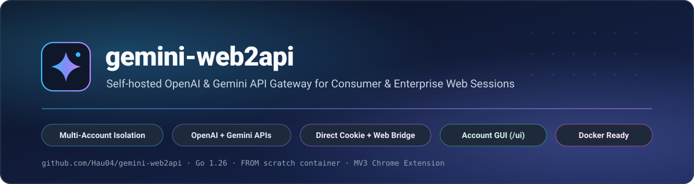

<p align="center">
  
</p>

<p align="center">
  <a href="https://github.com/Hau04/gemini-web2api/actions"></a>
  <a href="./Dockerfile"></a>
  <a href="./LICENSE"></a>
</p>

<p align="center">
  <strong>English</strong> · <a href="./README.zh-CN.md">简体中文</a>
</p>

A self-hosted Go gateway that turns **Gemini Consumer** (`gemini.google.com`) and **Gemini Enterprise** (`vertexaisearch.cloud.google.com`) web sessions into **OpenAI** and **Google Gemini** compatible APIs — with **multi-account isolation** and a built-in **Web GUI**.

## Features

- **OpenAI & Gemini APIs** — `/v1/chat/completions`, `/v1/responses`, `/v1/images/generations`, `/v1/videos/generations`, and `/v1beta/models/*`.
- **Multi-Account Isolation** — Run multiple Gemini accounts in one container with isolated cookies, sessions, and templates, selected via URL (`/a/<account_id>/v1`).
- **Account Manager GUI (`/ui`)** — Add/delete accounts, paste or upload `cookie.json`, monitor live cookie status, and copy per-account API URLs.
- **Direct Mode + Chrome Bridge** — Serves requests headlessly via synced cookies, with an optional Chrome MV3 extension (`extension/`) for auto-sync and fallback.
- **Tools & Multimodal** — Supports function calling, vision/file attachments, and streaming SSE.
- **Lightweight Docker Image** — Single static Go binary in a `scratch` container.

## Quick Start (Docker)

```bash
git clone https://github.com/Hau04/gemini-web2api.git
cd gemini-web2api
cp config.example.json config.json
mkdir -p data accounts
docker compose up -d --build
```

- **API Base URL:** `http://localhost:8081/v1`
- **Account Manager GUI:** `http://localhost:8081/ui`

## Setup Procedure

### 1. Connect Cookies (Choose One)

- **Chrome Extension (Recommended):**
  1. Open `chrome://extensions`, enable **Developer mode**, and **Load unpacked** → select `extension/`.
  2. Sign in to Gemini in Chrome.
  3. Open the extension popup, set your **Server URL** (and optional **Account ID** / **Bridge Token**), then click **Save & Sync Now**.
- **Manual via Web GUI:**
  1. Open `http://localhost:8081/ui`.
  2. Click **Update Cookies** on an account and paste or upload your `cookie.json`.

### 2. Add Multiple Isolated Accounts

1. Open `http://localhost:8081/ui` and click **+ Add Account** (e.g. `work`, `personal`).
2. Upload/paste that account's cookies (or sync from a separate Chrome profile with its **Account ID** set).
3. Point each client to its dedicated URL:

| Account | OpenAI Base URL | Google Base URL |
| :--- | :--- | :--- |
| `default` | `http://localhost:8081/v1` | `http://localhost:8081/v1beta` |
| `work` | `http://localhost:8081/a/work/v1` | `http://localhost:8081/a/work/v1beta` |

### 3. Test the API

```bash
curl http://localhost:8081/v1/chat/completions \
  -H "Content-Type: application/json" \
  -H "Authorization: Bearer sk-gemini" \
  -d '{"model":"gemini-3.6-flash","messages":[{"role":"user","content":"Hello!"}]}'
```

## Key Configuration (`config.json`)

| Key | Description |
| :--- | :--- |
| `port` | Server port (default `8081`) |
| `api_keys` | API keys for `/v1/*` and `/v1beta/*` (empty = open) |
| `bridge_token` | Shared secret protecting `/bridge/*` and `/api/accounts/*` |
| `cookie_file` | Default account cookie path (e.g. `/app/data/cookie.json`) |
| `default_model` | Fallback model when not specified (`gemini-3.6-flash`) |
| `proxy` | Optional HTTP/HTTPS/SOCKS5 proxy |

See [`config.example.json`](./config.example.json) for all options.

## License

[MIT](./LICENSE) — For personal and educational use only. Not affiliated with Google.
