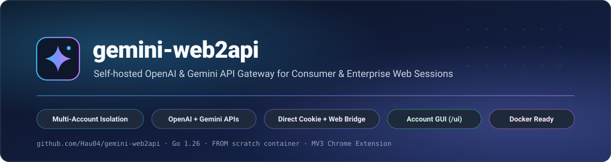

<p align="center">
  
</p>

<p align="center">
  <a href="https://github.com/Hau04/gemini-web2api/actions"></a>
  <a href="./Dockerfile"></a>
  <a href="./LICENSE"></a>
</p>

<p align="center">
  <a href="./README.md">English</a> · <strong>简体中文</strong>
</p>

一个基于 Go 的自托管网关，将 **Gemini 个人版**（`gemini.google.com`）和 **Gemini Enterprise**（`vertexaisearch.cloud.google.com`）网页会话转换为 **OpenAI** 与 **Google Gemini** 兼容 API，内置 **多账号隔离** 与 **Web 管理面板**。

## 核心特性

- **OpenAI & Gemini 双协议** — 支持 `/v1/chat/completions`、`/v1/responses`、`/v1/images/generations`、`/v1/videos/generations` 及 `/v1beta/models/*`。
- **多账号完全隔离** — 单容器运行多个 Gemini 账号，Cookie、会话和模板相互独立，通过路径区分账号（`/a/<account_id>/v1`）。
- **内置账号管理 GUI（`/ui`）** — 新增/删除账号、粘贴或上传 `cookie.json`、实时查看 Cookie 状态，一键复制专属 API 地址。
- **直连模式 + Chrome 扩展** — 同步 Cookie 后可无头运行，配合 Chrome MV3 扩展（`extension/`）实现自动同步与桥接。
- **工具调用与多模态** — 支持 Function Calling、图片/文件附件及 SSE 流式输出。
- **轻量 Docker 镜像** — 基于 `scratch` 的单文件静态 Go 二进制。

## 快速开始（Docker）

```bash
git clone https://github.com/Hau04/gemini-web2api.git
cd gemini-web2api
cp config.example.json config.json
mkdir -p data accounts
docker compose up -d --build
```

- **API 地址：** `http://localhost:8081/v1`
- **账号管理面板：** `http://localhost:8081/ui`

## 使用步骤

### 1. 导入 Cookie（任选其一）

- **Chrome 扩展自动同步（推荐）：**
  1. 打开 `chrome://extensions`，开启 **开发者模式**，点击 **加载已解压的扩展程序** → 选择 `extension/`。
  2. 在浏览器中登录 Gemini。
  3. 打开扩展弹窗，填写 **Server URL**（以及可选的 **Account ID** / **Bridge Token**），点击 **Save & Sync Now**。
- **Web 面板手动导入：**
  1. 打开 `http://localhost:8081/ui`。
  2. 点击对应账号的 **Update Cookies**，粘贴或上传 `cookie.json`。

### 2. 添加多个隔离账号

1. 在 `http://localhost:8081/ui` 点击 **+ Add Account**（如 `work`、`personal`）。
2. 为新账号上传/粘贴 Cookie（或在另一个 Chrome 配置文件的扩展中填写对应的 **Account ID** 自动同步）。
3. 在客户端使用对应账号的 API 地址：

| 账号 | OpenAI Base URL | Google Base URL |
| :--- | :--- | :--- |
| `default` | `http://localhost:8081/v1` | `http://localhost:8081/v1beta` |
| `work` | `http://localhost:8081/a/work/v1` | `http://localhost:8081/a/work/v1beta` |

### 3. 测试接口

```bash
curl http://localhost:8081/v1/chat/completions \
  -H "Content-Type: application/json" \
  -H "Authorization: Bearer sk-gemini" \
  -d '{"model":"gemini-3.6-flash","messages":[{"role":"user","content":"你好！"}]}'
```

## 支持的模型

可随时请求 `GET /v1/models` 获取实时列表，或直接使用以下模型名称：

| 模型 ID | 别名 | 说明 |
| :--- | :--- | :--- |
| `gemini-4-neon` | `neon`, `gemini-4-neon-thinking` | 前沿旗舰模型（Gemini 4 Neon） |
| `gemini-4-hydrogen` | `hydrogen` | 高速前沿执行模型（Gemini 4 Hydrogen） |
| `gemini-4-argon` | `argon`, `gemini-4` | 复杂任务旗舰模型（Gemini 4 Argon） |
| `gemini-4-carbon` | `carbon` | 前沿模型（Gemini 4 Carbon） |
| `gemini-3.8-flash` | — | 最新全能 Flash 模型 |
| `gemini-3.7-flash` | — | 全能 Flash 模型 |
| `gemini-3.6-flash` | `gemini-3.5-flash` | 默认全能 Flash 模型 |
| `gemini-3.5-flash-thinking` | — | 深度思考模式（超长输出 ~20k 字符） |
| `gemini-3.5-flash-thinking-lite` | — | 动态自适应思考模型 |
| `gemini-3.1-pro` | `gemini-3.1-pro-enhanced` | Pro 模型（需要登录 Cookie） |
| `gemini-2.5-pro` | — | Gemini 2.5 Pro |
| `gemini-flash-lite` | — | 轻量高速模型 |
| `gemini-auto` | — | 自动选择模型 |

**可选后缀：** 支持拼接 `@think=0..4`（`0` 最深，`4` 最浅）、`@new` 或 `@continue`（例如 `gemini-4-hydrogen@think=0@new`）。

## 常用配置（`config.json`）

| 配置项 | 说明 |
| :--- | :--- |
| `port` | 监听端口（默认 `8081`） |
| `api_keys` | `/v1/*` 与 `/v1beta/*` 的访问密钥（留空则不鉴权） |
| `bridge_token` | 保护 `/bridge/*` 与 `/api/accounts/*` 的共享密钥 |
| `cookie_file` | 默认账号 Cookie 文件路径（如 `/app/data/cookie.json`） |
| `default_model` | 未指定模型时的默认值（`gemini-3.6-flash`） |
| `proxy` | 可选 HTTP/HTTPS/SOCKS5 代理 |

完整配置项见 [`config.example.json`](./config.example.json)。

## 开源协议

[MIT](./LICENSE) — 仅供个人学习与研究使用，与 Google 无关。
