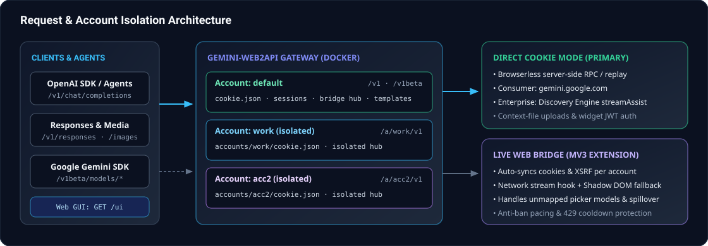

<p align="center">
  
</p>

<p align="center">
  <a href="https://github.com/Hau04/gemini-web2api/actions"></a>
  <a href="https://github.com/Hau04/gemini-web2api/blob/main/go.mod"></a>
  <a href="https://github.com/Hau04/gemini-web2api/blob/main/Dockerfile"></a>
  <a href="./LICENSE"></a>
</p>

<p align="center">
  <a href="./README.md">English</a> · <strong>简体中文</strong>
</p>

> **免责声明：** 本项目仅供个人学习与研究使用，是非官方的 Gemini 网页会话代理工具，与 Google 无任何关联。自动化调用网页会话可能违反 Google 服务条款并导致账号受限，请自行承担使用风险。

---

## 项目简介

**`gemini-web2api`** 是一个基于 Go 构建的自托管 HTTP API 网关，可将现有的 **Gemini 个人版**（`gemini.google.com`）、**Gemini Enterprise**（`vertexaisearch.cloud.google.com`）与 **Gemini Business**（`business.gemini.google`）网页会话转换为标准的 **OpenAI 兼容** 与 **Google Gemini 兼容** API。

项目专为 **Docker 部署**（或单文件二进制运行）设计，结合了无需浏览器的 **直连 Cookie 模式** 与 **Chrome MV3 Live Web Bridge** 扩展，并内置了 **多账号隔离与 Web 管理面板（`/ui`）**。

<p align="center">
  
</p>

---

## 核心特性

| 特性 | 说明 |
| :--- | :--- |
| **多协议 API 支持** | 支持 OpenAI Chat Completions（`/v1/chat/completions`）、OpenAI Responses（`/v1/responses`）、图像/视频生成（`/v1/images/generations`、`/v1/videos/generations`）、Google Gemini（`/v1beta/models/{model}:generateContent` 与 `:streamGenerateContent`）以及模型诊断接口（`/v1/model-info`、`/v1/model-probe`）。 |
| **多账号完全隔离** | 单实例同时托管多个 Google/Gemini 账号，各自拥有独立的 `cookie.json`、Discovery Engine 模板、模型缓存、Bridge 队列与会话上下文，直接通过 API 路径区分账号（`/a/<account_id>/v1`）。 |
| **内置账号管理 GUI（`/ui`）** | 浏览器直连管理：新增/删除账号、粘贴或上传 `cookie.json`、实时查看 Cookie 与 Bridge 健康状态（`Cookies Ready`、`Session Expired`、`No Cookies`、`SAPISID`、`1PSID`、`XSRF`），一键复制各账号专属 API 地址。 |
| **双通道传输引擎** | **直连 Cookie 模式**可在浏览器关闭时无头运行；**Live Web Bridge**（Chrome MV3 扩展）自动同步 Cookie/XSRF，并兜底处理未映射的 Enterprise 模型选择与超大 Prompt 溢出。 |
| **Agent 与工具调用优化** | 完整支持 OpenAI/Google Function Calling、并行工具调用、MCP/连接器透传、针对 Gemini 4 高级模型的 `prevent_deep_research` 防护、可选 `tool_model` 路由及客户端标题请求本地快速响应。 |
| **企业版附件与防封号保护** | 自动回放 Discovery Engine `widgetStreamAssist` / `widgetAddContextFile`、本地文件自动转上下文附件、请求频率控制、429 冷却持久化与 Cookie 过期 Webhook 通知（`ntfy`、`discord`、`slack`、`generic`）。 |

---

## 快速开始（Docker — 推荐）

```bash
git clone https://github.com/Hau04/gemini-web2api.git
cd gemini-web2api
cp config.example.json config.json
mkdir -p data accounts
docker compose up -d --build
```

启动后访问：

- **默认 OpenAI API 地址：** `http://localhost:8081/v1`
- **默认 Google API 地址：** `http://localhost:8081/v1beta`
- **账号管理面板（GUI）：** `http://localhost:8081/ui`

### 持久化挂载（`docker-compose.yml`）

- `./config.json:/app/config.json` — 服务配置与 API Key
- `./data:/app/data` — 默认账号的 Cookie 与模板数据
- `./accounts:/app/accounts` — 多账号隔离数据目录

> **提示（Docker 网络）：** 若在 Docker 默认桥接网络下遇到空响应，可在 `docker-compose.yml` 中切换为 `network_mode: host`。

---

## 源码运行

需要 **Go 1.26+**。

```bash
git clone https://github.com/Hau04/gemini-web2api.git
cd gemini-web2api
cp config.example.json config.json
go run .
```

---

## 多账号隔离与管理面板

访问 **`http://<host>:8081/ui`** 即可在同一个容器内管理多个 Gemini 账号。

| 账号 | OpenAI Base URL | Google Base URL | 扩展同步地址 |
| :--- | :--- | :--- | :--- |
| `default` | `http://<host>:8081/v1` | `http://<host>:8081/v1beta` | `http://<host>:8081` |
| `work` | `http://<host>:8081/a/work/v1` | `http://<host>:8081/a/work/v1beta` | `http://<host>:8081/a/work` |
| `personal` | `http://<host>:8081/a/personal/v1` | `http://<host>:8081/a/personal/v1beta` | `http://<host>:8081/a/personal` |

在未加前缀的路径上，也支持通过请求头 `X-Gemini-Account: <id>` 或查询参数 `?account=<id>` 指定账号；所有响应头均会返回 `X-Gemini-Account`。

### 账号管理 REST API

| 接口 | 说明 |
| :--- | :--- |
| `GET /api/accounts` | 获取所有账号列表与 Cookie / Bridge 实时状态 |
| `POST /api/accounts` | 创建隔离账号（`id`、`label`，可选 `raw`/`cookie`） |
| `DELETE /api/accounts/{id}` | 删除指定账号及其隔离目录 |
| `PUT /api/accounts/{id}/cookies` | 上传或粘贴 `cookie.json` / 原始 `Cookie:` 字符串 |
| `DELETE /api/accounts/{id}/cookies` | 清除指定账号的已保存 Cookie |

> 配置了 `bridge_token` 或 `api_keys` 时，`/api/accounts/*` 会自动启用鉴权，`/ui` 页面会提示输入一次令牌解锁。

---

## 浏览器扩展安装

项目内置的 Chrome MV3 扩展（`extension/`）可自动同步 Cookie、XSRF 与 Discovery Engine 模板，并提供 Live Web Bridge 通道。

1. 打开 `chrome://extensions` 并开启 **开发者模式**。
2. 点击 **加载已解压的扩展程序**，选择 `extension/` 目录。
3. 在浏览器中登录 `gemini.google.com` 或 `vertexaisearch.cloud.google.com`。
4. 点击扩展图标，填写 **Server URL**（如 `http://localhost:8081` 或 Cloudflare Tunnel 地址）、可选 **Account ID**（多 Chrome 配置文件时可填 `work` 等账号 ID）及可选 **Bridge Token**，点击 **Save & Sync Now**。

---

## 配置说明（`config.json`）

完整配置项请参考 [`config.example.json`](./config.example.json)，常用项如下：

| 字段 | 默认值 | 说明 |
| :--- | :--- | :--- |
| `port` / `host` | `8081` / `"0.0.0.0"` | 监听端口与绑定地址 |
| `api_keys` | `[]` | 允许的 API Key（支持 `Authorization: Bearer`、`x-api-key`、`x-goog-api-key`、`?key=`） |
| `bridge_token` | `""` | 保护 `/bridge/*` 与 `/api/accounts/*` 的共享密钥 |
| `cookie_file` | `"cookie.json"` | 默认账号的 Cookie 文件路径 |
| `accounts_dir` | `""` | 隔离账号存储目录（默认 `<cookie-dir>/accounts`） |
| `default_model` | `"gemini-3.6-flash"` | 请求未指定 `model` 时的默认模型 |
| `tool_model` | `""` | 含工具调用请求的可选模型重定向 |
| `prevent_deep_research` | `true` | 防止高级模型在工具调用时漂移至 Deep Research |
| `base_url` | `"https://gemini.google.com"` | 默认上游 Gemini 地址 |
| `proxy` | `""` | 可选 HTTP/HTTPS/SOCKS5 代理 |
| `impersonate` | `""` | 可选 TLS 指纹伪装配置 |
| `notify_webhook` | `""` | 会话过期通知 Webhook（`ntfy`、`discord`、`slack`、`generic`） |

---

## API 调用示例

### OpenAI Chat Completions（指定隔离账号）

```bash
curl http://localhost:8081/a/work/v1/chat/completions \
  -H "Content-Type: application/json" \
  -H "Authorization: Bearer sk-gemini" \
  -d '{
    "model": "gemini-3.6-flash",
    "messages": [{"role": "user", "content": "你好！"}],
    "stream": true
  }'
```

### Google Gemini API

```bash
curl "http://localhost:8081/v1beta/models/gemini-3.6-flash:generateContent?key=sk-gemini" \
  -H "Content-Type: application/json" \
  -d '{"contents":[{"parts":[{"text":"你好！"}]}]}'
```

---

## 开源协议

MIT — 详见 [LICENSE](./LICENSE)。
